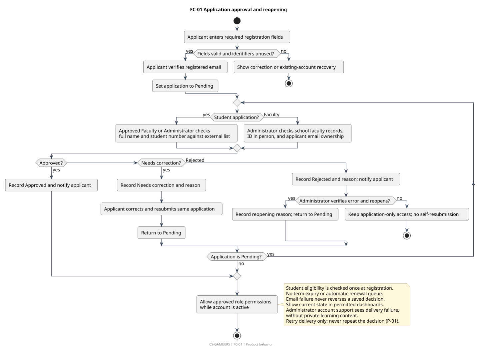
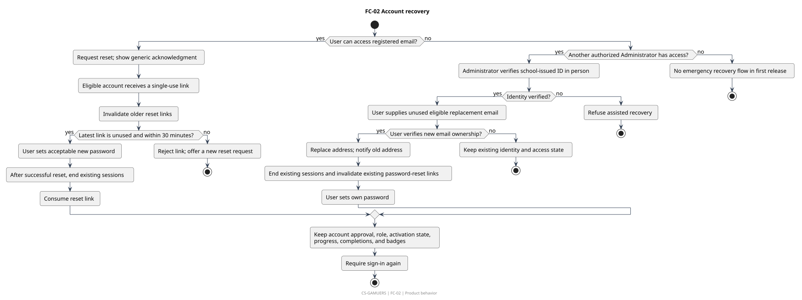
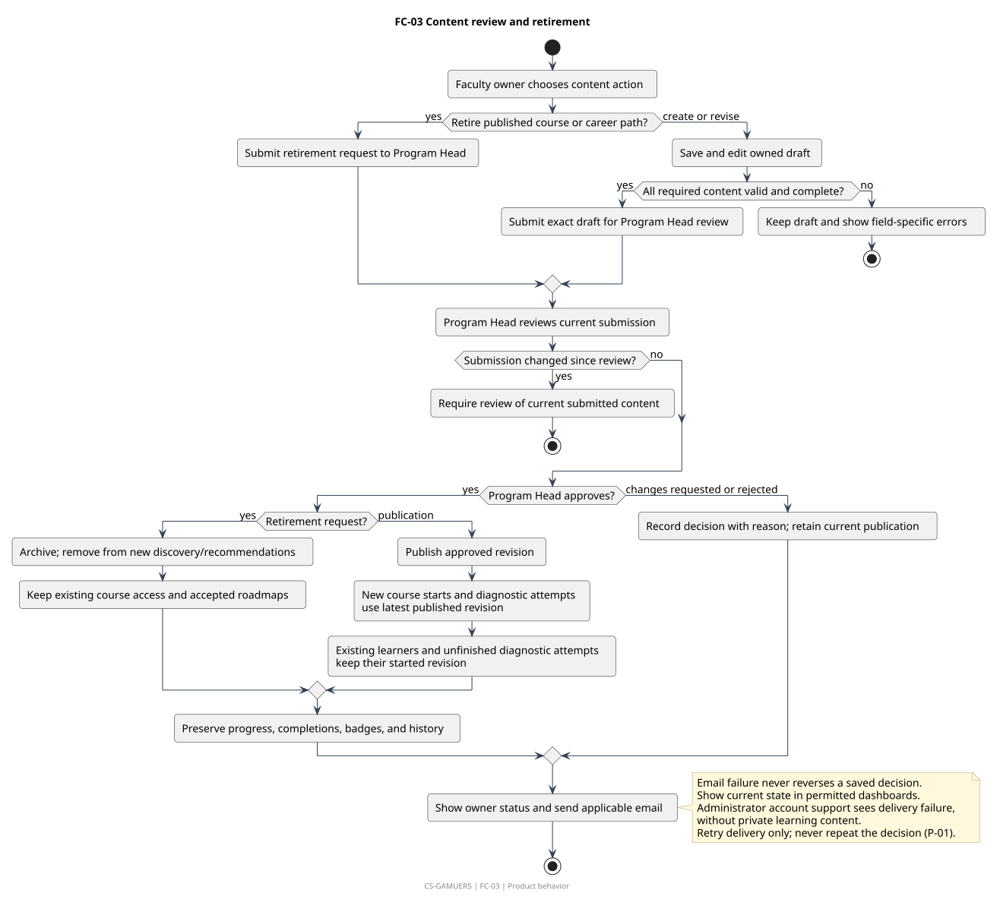
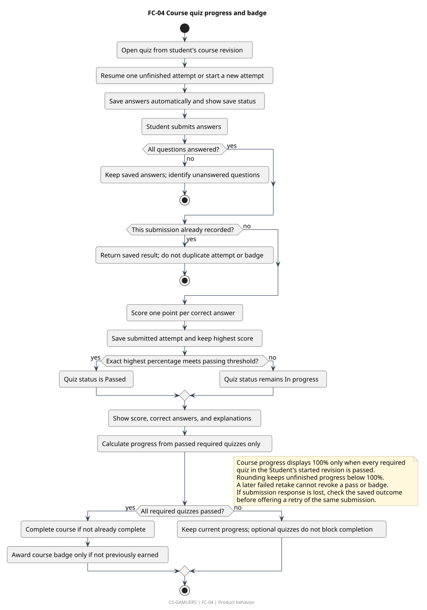
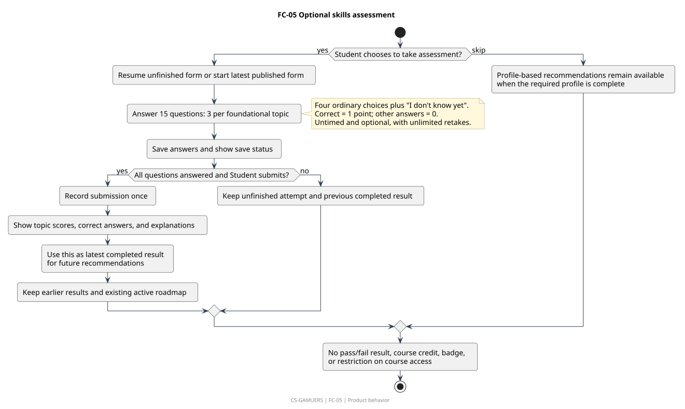
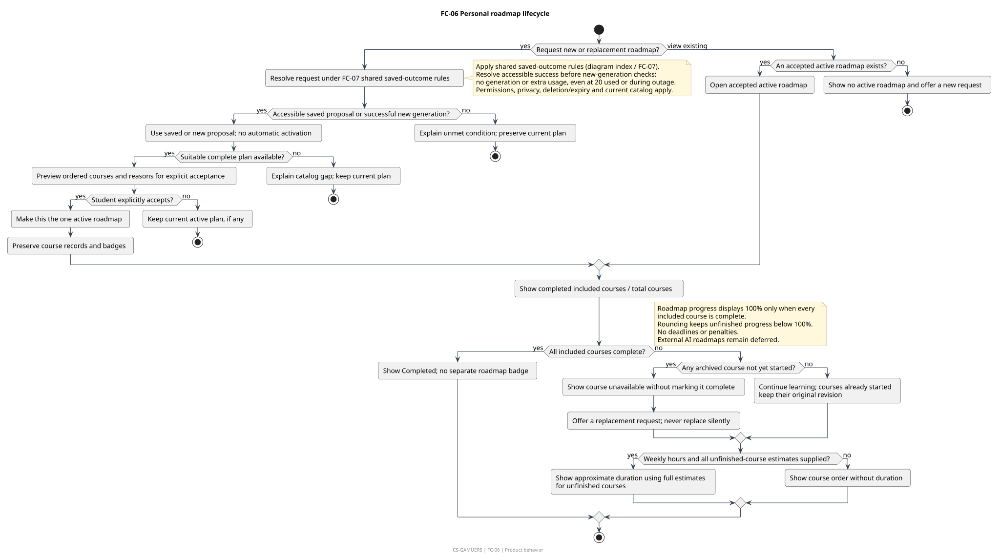
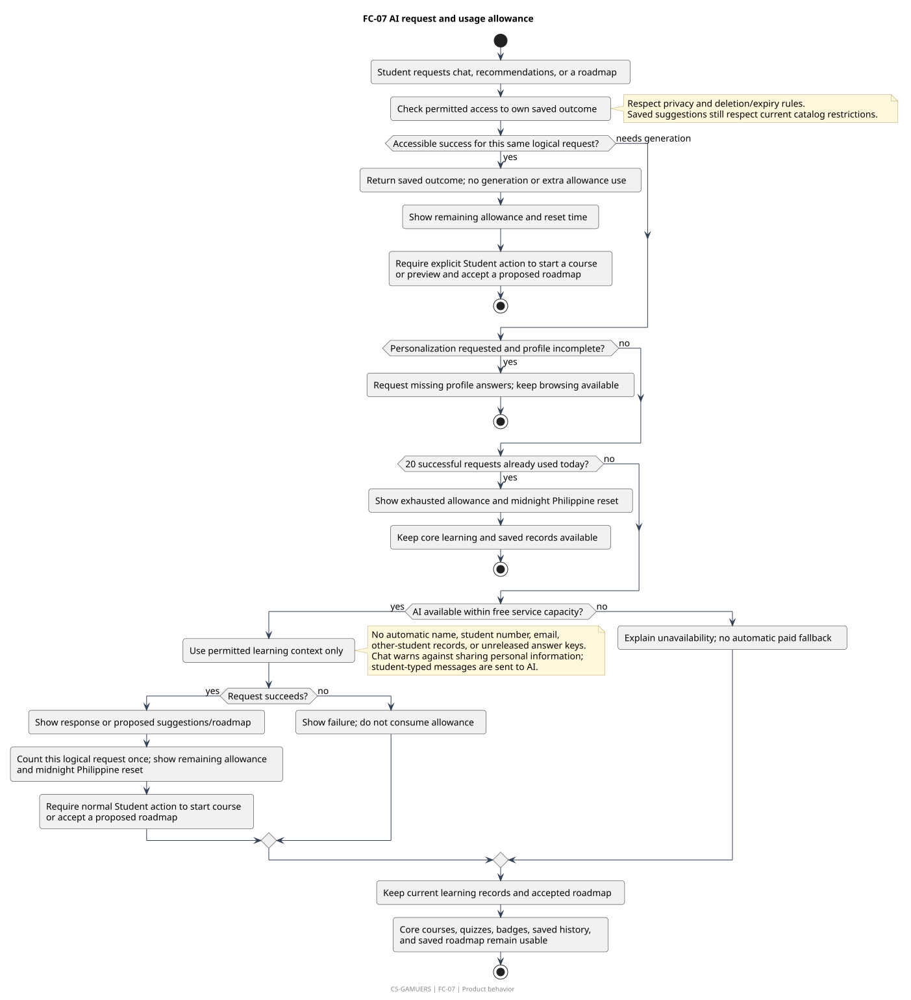
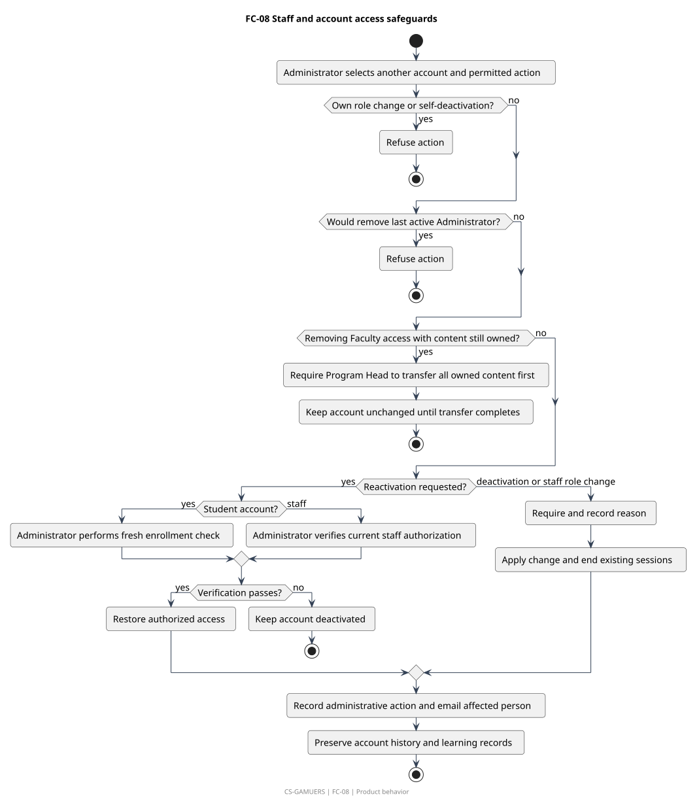

# Flowcharts

[All diagrams](../README.md) · [Approved PRD](../../../PRD.md)

| ID | Diagram | Preview | Editable source |
|---|---|---|---|
| FC-01 | Application approval and reopening | [SVG](fc-01.svg) | [PlantUML](fc-01.puml) |
| FC-02 | Account recovery | [SVG](fc-02.svg) | [PlantUML](fc-02.puml) |
| FC-03 | Content review and retirement | [SVG](fc-03.svg) | [PlantUML](fc-03.puml) |
| FC-04 | Course quiz progress and badge | [SVG](fc-04.svg) | [PlantUML](fc-04.puml) |
| FC-05 | Optional skills assessment | [SVG](fc-05.svg) | [PlantUML](fc-05.puml) |
| FC-06 | Personal roadmap lifecycle | [SVG](fc-06.svg) | [PlantUML](fc-06.puml) |
| FC-07 | AI request and usage allowance | [SVG](fc-07.svg) | [PlantUML](fc-07.puml) |
| FC-08 | Staff and account access safeguards | [SVG](fc-08.svg) | [PlantUML](fc-08.puml) |

## FC-01 Application approval and reopening

Application states are separate from active/deactivated account state. Email ownership alone does not grant learning or staff permissions. Email failures retain permitted dashboard state; Administrator support sees delivery failure without private learning content, and retries deliver only (P-01).

[Editable source](fc-01.puml). Requirements: PERM-01, PERM-02, PERM-05, ACC-01, ACC-02, ACC-03, ACC-04, ACC-05, ACC-06, ACC-07, ACC-08, ACC-20, NOTICE-01, NOTICE-02, P-01.

## FC-02 Account recovery

Normal email reset and Administrator-assisted email replacement preserve account approval, activation, and learning records. Assisted replacement ends sessions and invalidates reset links before password setup; normal reset ends sessions after successful password change.

[Editable source](fc-02.puml). Requirements: ACC-04, ACC-13, ACC-14, ACC-15, ACC-16, DATA-01, NOTICE-02.

## FC-03 Content review and retirement

Publication and ordinary archive are review decisions. Existing learner requirements stay fixed to their started revision. Failed email preserves the decision and permitted dashboard state; Administrator support sees delivery failure without private learning content, and retries deliver only (P-01).

[Editable source](fc-03.puml). Requirements: CONTENT-01, CONTENT-02, CONTENT-03, CONTENT-04, CONTENT-05, CONTENT-06, CONTENT-07, CONTENT-08, PATH-01, PATH-02, PATH-03, ASSESS-01, ASSESS-05, NOTICE-01, NOTICE-02, P-01, P-02, P-03.

## FC-04 Course quiz progress and badge

Progress depends only on required quizzes from the Student's started revision. Passing is based on the exact score, not rounded display values. Course progress displays 100% only after all required quizzes in that revision pass; rounding keeps unfinished progress below 100%.

[Editable source](fc-04.puml). Requirements: QUIZ-01, QUIZ-02, QUIZ-03, QUIZ-04, QUIZ-05, QUIZ-06, QUIZ-07, QUIZ-08, PROGRESS-01, PROGRESS-02, REWARD-01, REWARD-02, CONTENT-06, P-03, P-04.

## FC-05 Optional skills assessment

The shared diagnostic provides topic-level guidance and does not award completion, badges, or career eligibility.

[Editable source](fc-05.puml). Requirements: ASSESS-01, ASSESS-02, ASSESS-03, ASSESS-04, ASSESS-05, PROFILE-01, REC-01, QUIZ-05, QUIZ-06, QUIZ-07.

## FC-06 Personal roadmap lifecycle

Students choose whether to accept a new or replacement roadmap. Archived unstarted courses remain visibly unavailable until the Student accepts another plan. Saved proposals follow FC-07 retrieval before generation gates and still require preview and explicit acceptance. Roadmap progress displays 100% only when every included course is complete; unfinished progress stays below 100% after rounding.

[Editable source](fc-06.puml). Requirements: ROAD-01, ROAD-02, ROAD-03, ROAD-04, ROAD-05, ROAD-06, ROAD-07, ROAD-08, ROAD-09, PROGRESS-03, PROFILE-01, AI-05, AI-06, P-04, P-05.

## FC-07 AI request and usage allowance

One allowance covers a successful logical request even when recommendations are made through chat. Availability failures preserve ordinary learning. Accessible saved success is returned before new-generation gates, including exhausted allowance or AI unavailability, with no generation or extra usage. New requests remain subject to those gates.

[Editable source](fc-07.puml). Requirements: AI-01, AI-02, AI-03, AI-04, AI-05, AI-06, AI-07, REC-01, REC-02, REC-03, REC-04, PROFILE-01, ROAD-01, ROAD-02, ROAD-03, DATA-01.

## FC-08 Staff and account access safeguards

Administrator-managed account changes cannot remove the last Administrator or abandon Faculty-owned content.

[Editable source](fc-08.puml). Requirements: PERM-01, PERM-04, ACC-11, ACC-12, ACC-17, ACC-18, ACC-19, NOTICE-01, NOTICE-02, REPORT-03, P-08.
