# System sequence diagrams

[All diagrams](../README.md) · [Approved PRD](../../../PRD.md)

| ID | Diagram | Preview | Editable source |
|---|---|---|---|
| SS-01 | Register and review an application | [SVG](ss-01.svg) | [PlantUML](ss-01.puml) |
| SS-02 | Invite and activate privileged staff | [SVG](ss-02.svg) | [PlantUML](ss-02.puml) |
| SS-03 | Reset a forgotten password | [SVG](ss-03.svg) | [PlantUML](ss-03.puml) |
| SS-04 | Recover access after losing email | [SVG](ss-04.svg) | [PlantUML](ss-04.puml) |
| SS-05 | Manage another account access | [SVG](ss-05.svg) | [PlantUML](ss-05.puml) |
| SS-06 | Student self-deactivation and return | [SVG](ss-06.svg) | [PlantUML](ss-06.puml) |
| SS-07 | Review and publish learning content | [SVG](ss-07.svg) | [PlantUML](ss-07.puml) |
| SS-08 | Transfer ownership or assign assessment owner | [SVG](ss-08.svg) | [PlantUML](ss-08.puml) |
| SS-09 | Retire a course or career path | [SVG](ss-09.svg) | [PlantUML](ss-09.puml) |
| SS-10 | Find and start a course | [SVG](ss-10.svg) | [PlantUML](ss-10.puml) |
| SS-11 | Save and submit a quiz or assessment | [SVG](ss-11.svg) | [PlantUML](ss-11.puml) |
| SS-12 | Request personalized suggestions | [SVG](ss-12.svg) | [PlantUML](ss-12.puml) |
| SS-13 | Preview and accept a personal roadmap | [SVG](ss-13.svg) | [PlantUML](ss-13.puml) |
| SS-14 | Ask AI through chat | [SVG](ss-14.svg) | [PlantUML](ss-14.puml) |
| SS-15 | Read, delete, or expire a conversation | [SVG](ss-15.svg) | [PlantUML](ss-15.puml) |
| SS-16 | View permitted reports or history | [SVG](ss-16.svg) | [PlantUML](ss-16.puml) |

## SS-01 Register and review an application

Student and Faculty applications share the status flow, but have different reviewers and identity checks. P-01 preserves decisions and permitted dashboard state after email failure, exposes delivery failure to Administrator support without private learning content, and retries delivery only.

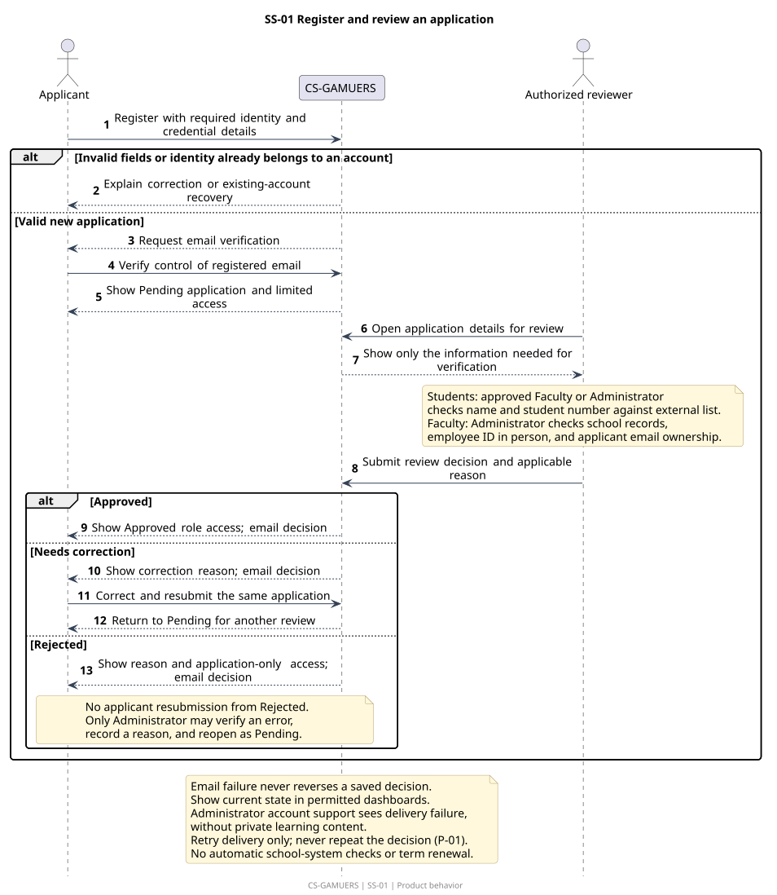

[Editable source](ss-01.puml). Requirements: PERM-01, PERM-02, PERM-05, ACC-01, ACC-02, ACC-03, ACC-04, ACC-05, ACC-06, ACC-07, ACC-08, ACC-20, NOTICE-01, NOTICE-02, P-01, P-03.

## SS-02 Invite and activate privileged staff

Only an approved Administrator invites another Administrator or a Program Head; acceptance is tied to the intended email.

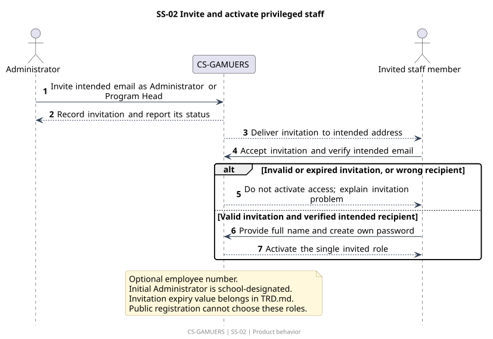

[Editable source](ss-02.puml). Requirements: ACC-09, ACC-10, PERM-01, NOTICE-02.

## SS-03 Reset a forgotten password

A generic acknowledgment avoids revealing whether an email has an account; successful reset preserves approval and activation state.

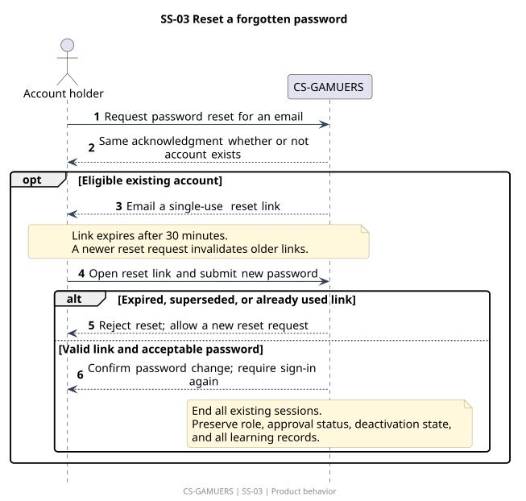

[Editable source](ss-03.puml). Requirements: ACC-05, ACC-13, ACC-14, ACC-16, NOTICE-02.

## SS-04 Recover access after losing email

An Administrator verifies identity offline before authorizing a verified replacement email; this is not an emergency fallback when all Administrators are locked out. Address replacement and old-address notice precede session/reset-link invalidation, which precedes own-password setup even if setup is abandoned.

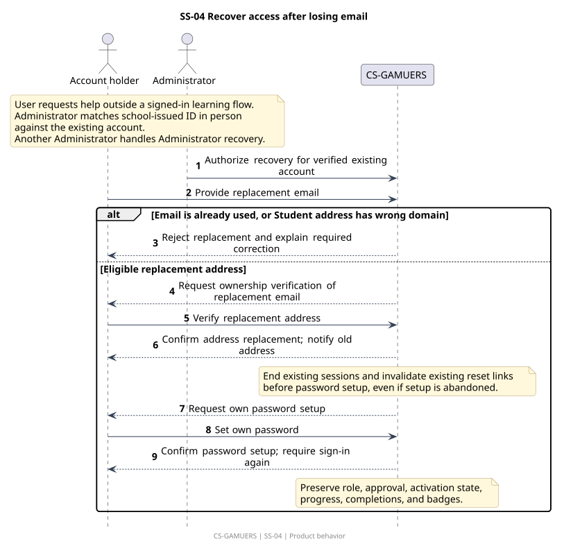

[Editable source](ss-04.puml). Requirements: ACC-04, ACC-15, ACC-16, NOTICE-02, DATA-01.

## SS-05 Manage another account access

Administrator-initiated deactivation, reactivation, and staff-role changes use the same safeguards, applied only where relevant to the requested action.

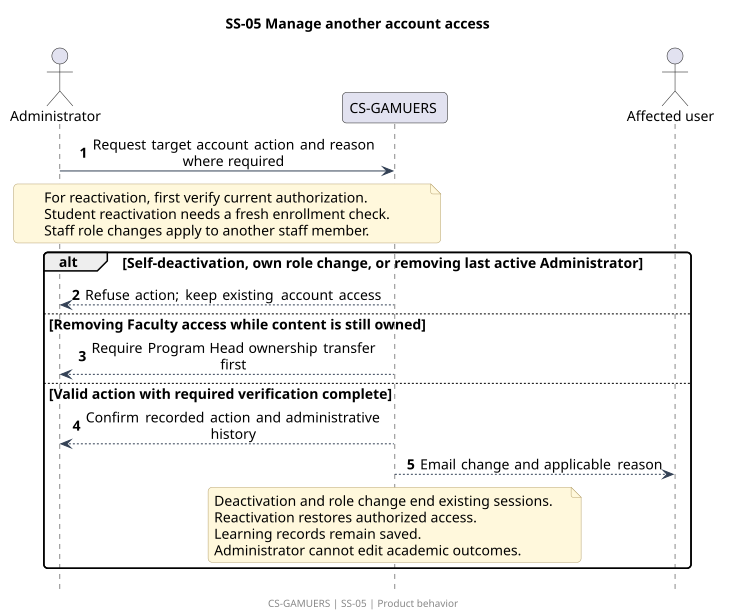

[Editable source](ss-05.puml). Requirements: ACC-11, ACC-12, ACC-18, ACC-19, PERM-01, PERM-04, REPORT-03, NOTICE-01, NOTICE-02, P-08.

## SS-06 Student self-deactivation and return

Self-deactivation preserves records; return requires Administrator approval after a fresh enrollment check.

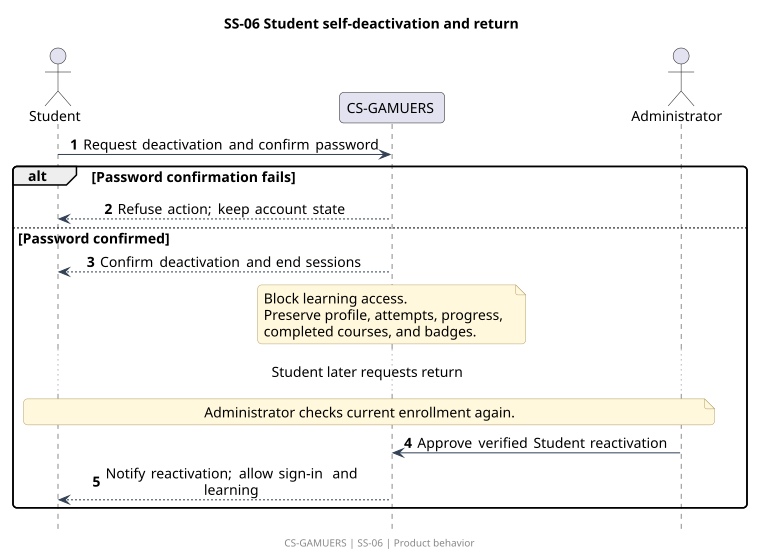

[Editable source](ss-06.puml). Requirements: ACC-17, ACC-18, DATA-01, NOTICE-01, NOTICE-02.

## SS-07 Review and publish learning content

One publication process covers owned courses, career paths, and the assigned shared assessment, with type-specific required fields. P-01 preserves publication and permitted dashboard state after email failure; Administrator support sees delivery failure without private learning content, and retries deliver only.

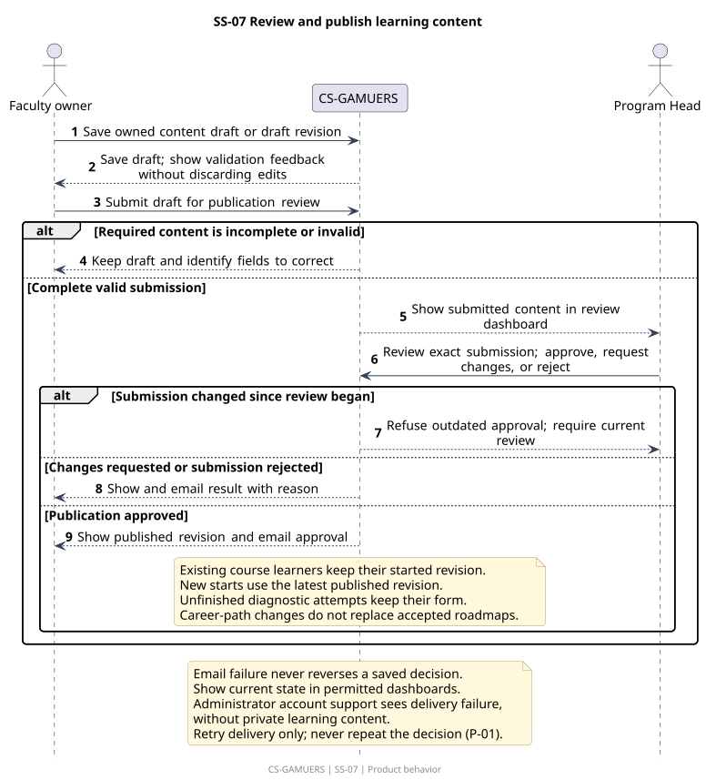

[Editable source](ss-07.puml). Requirements: CONTENT-01, CONTENT-02, CONTENT-03, CONTENT-04, CONTENT-05, CONTENT-06, PATH-01, PATH-02, PATH-03, ASSESS-01, ASSESS-02, ASSESS-05, NOTICE-01, NOTICE-02, P-01, P-02, P-03.

## SS-08 Transfer ownership or assign assessment owner

Program Heads assign or transfer to an approved Faculty member. Ownership does not extend student-record access beyond owned courses.

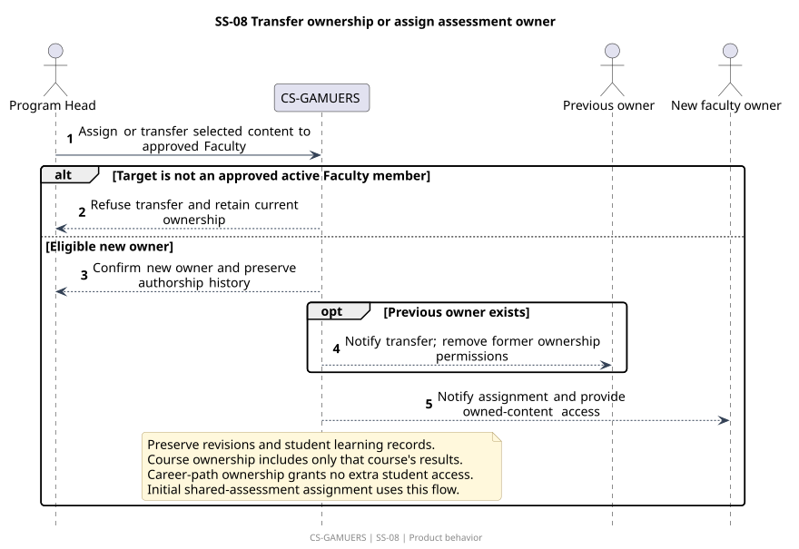

[Editable source](ss-08.puml). Requirements: PERM-03, CONTENT-01, PATH-02, ASSESS-01, ACC-12, ACC-18, NOTICE-01.

## SS-09 Retire a course or career path

Archiving stops new starts or recommendations while preserving the explicitly approved access for existing learners.

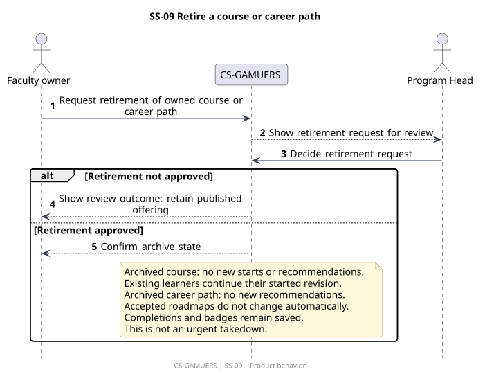

[Editable source](ss-09.puml). Requirements: CONTENT-07, CONTENT-08, PATH-02, PATH-03, DISC-04, ROAD-05, ROAD-06, DATA-01, NOTICE-01.

## SS-10 Find and start a course

An approved Student can start learning without a complete personalization profile; the published revision is selected at the moment of the first start.

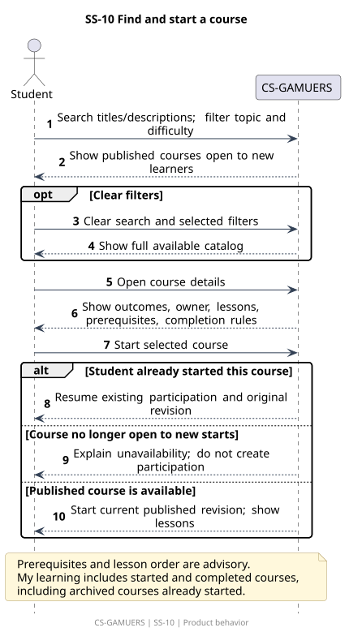

[Editable source](ss-10.puml). Requirements: PROFILE-01, PROFILE-02, DISC-01, DISC-02, DISC-03, DISC-04, CONTENT-03, CONTENT-06, CONTENT-07.

## SS-11 Save and submit a quiz or assessment

A common attempt flow saves answers and prevents duplicate outcomes; course quizzes and the optional diagnostic keep different grading and reward rules. Course progress displays 100% only when every required quiz in the started revision is passed; rounding keeps unfinished progress below 100%, independently of exact quiz scoring.

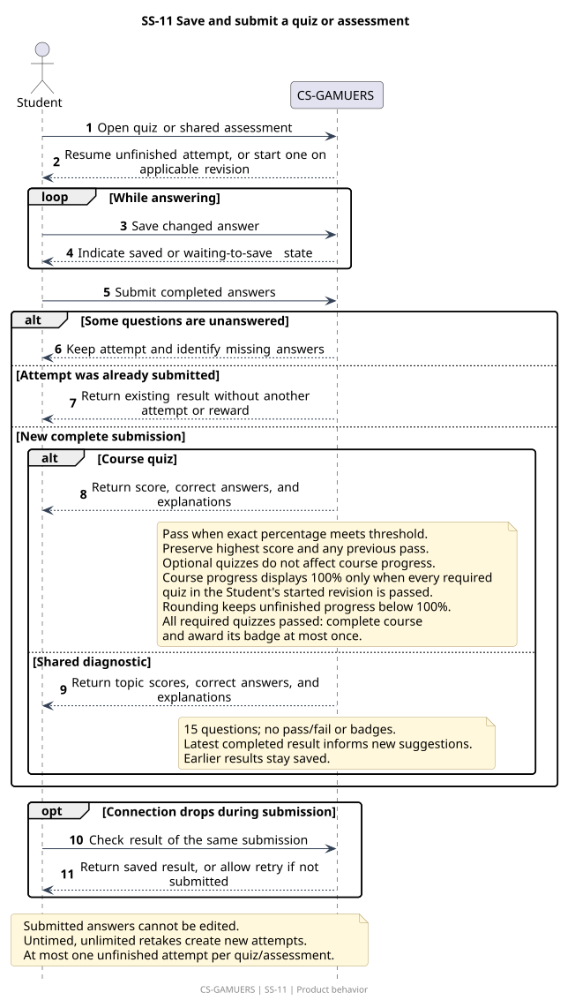

[Editable source](ss-11.puml). Requirements: ASSESS-01, ASSESS-02, ASSESS-03, ASSESS-04, ASSESS-05, QUIZ-01, QUIZ-02, QUIZ-03, QUIZ-04, QUIZ-05, QUIZ-06, QUIZ-07, QUIZ-08, PROGRESS-01, PROGRESS-02, PROGRESS-03, REWARD-01, REWARD-02, CONTENT-06, DATA-01, P-03, P-04.

## SS-12 Request personalized suggestions

The same catalog and profile rules apply to standalone requests and requests made through AI chat. Accessible saved success precedes new-generation checks, including allowance and availability, under the shared rules; retrieval uses no extra allowance.

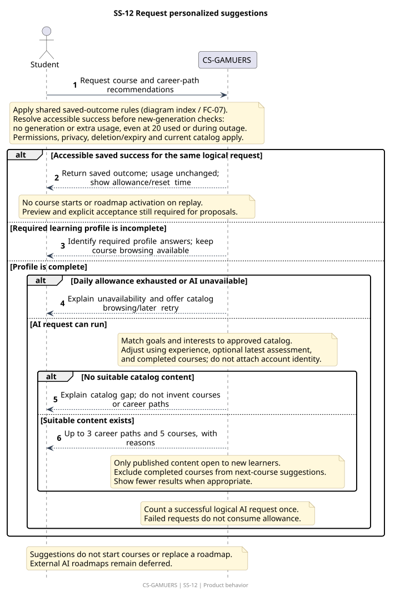

[Editable source](ss-12.puml). Requirements: PROFILE-01, PROFILE-02, REC-01, REC-02, REC-03, REC-04, AI-02, AI-04, AI-05, AI-06, ROAD-09.

## SS-13 Preview and accept a personal roadmap

A proposed plan does not become active until the Student accepts it. Its course references do not reserve old revisions for courses not yet started. Saved proposals are retrieved before generation gates under FC-07 and still lead to preview and explicit acceptance. Roadmap progress displays 100% only when every included course is complete; rounding keeps unfinished progress below 100%.

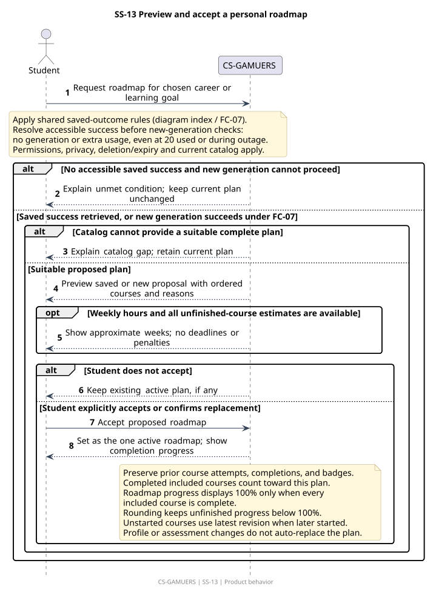

[Editable source](ss-13.puml). Requirements: PROFILE-01, ROAD-01, ROAD-02, ROAD-03, ROAD-04, ROAD-05, ROAD-06, ROAD-07, ROAD-08, PROGRESS-03, REC-01, AI-05, AI-06, DATA-01, P-04, P-05.

## SS-14 Ask AI through chat

Chat can explain and recommend, but cannot bypass profile requirements, catalog constraints, or explicit Student acceptance. Accessible saved success is retrieved before generation gates, including exhausted allowance and AI outage, without new generation or extra usage; replay does not start courses or accept proposals.

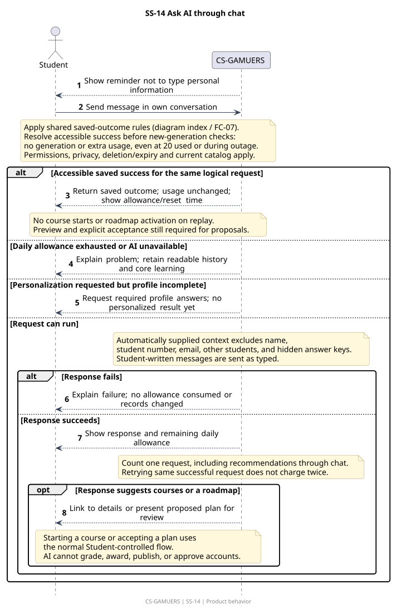

[Editable source](ss-14.puml). Requirements: AI-01, AI-02, AI-03, AI-04, AI-05, AI-06, AI-07, REC-01, REC-02, REC-03, ROAD-01, ROAD-02, ROAD-03, PROFILE-01, DATA-01.

## SS-15 Read, delete, or expire a conversation

Private history may be read without AI usage; expiry and Student deletion remove it from accessible history and future AI context without removing learning records. Expiry occurs exactly 90 days after the last message; history is unavailable at and after that boundary.

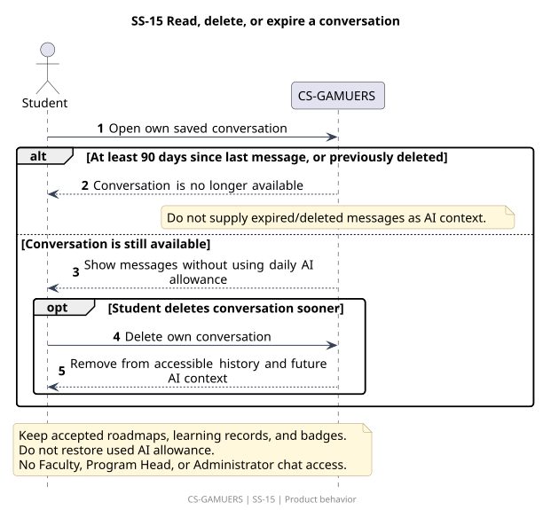

[Editable source](ss-15.puml). Requirements: AI-05, AI-07, DATA-01, PERM-02, PERM-03, PERM-04.

## SS-16 View permitted reports or history

The requested report and requester role determine the permitted information. Aggregate reports use start-date cohorts and small-group protection.

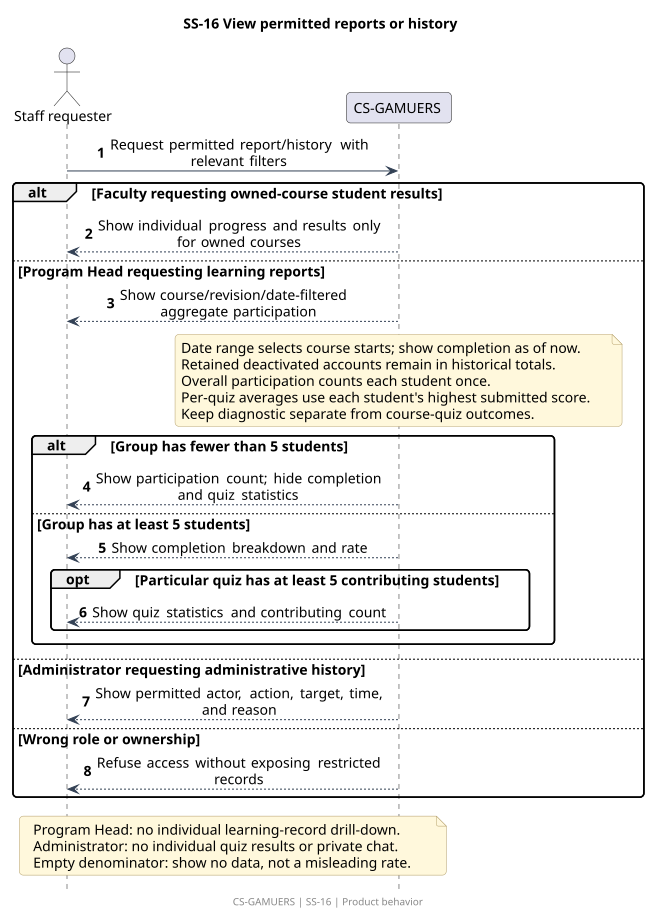

[Editable source](ss-16.puml). Requirements: PERM-02, PERM-03, PERM-04, REPORT-01, REPORT-02, REPORT-03, NOTICE-01, DATA-01, P-07.
