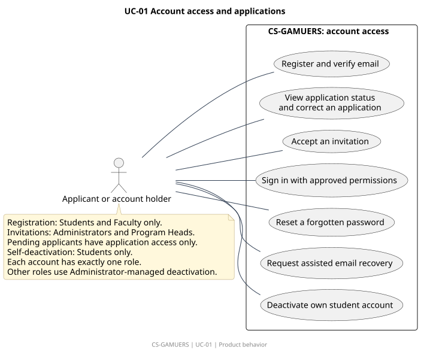
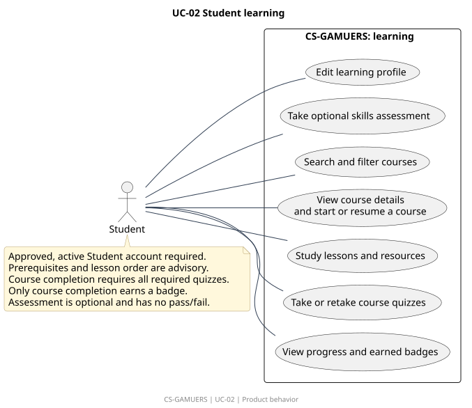
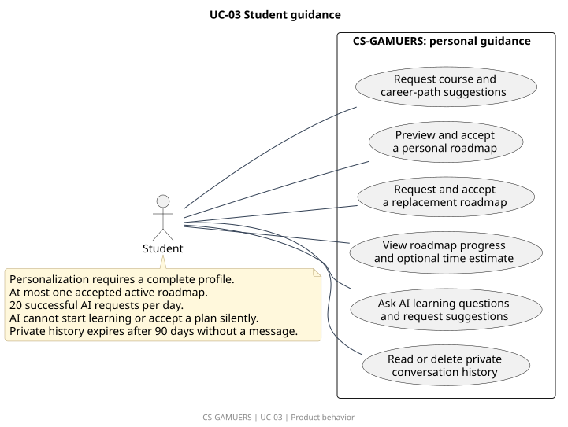
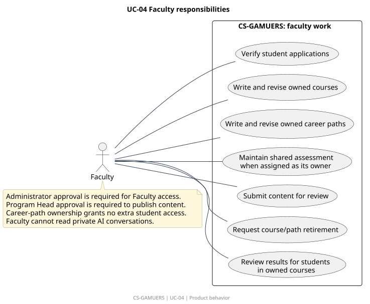
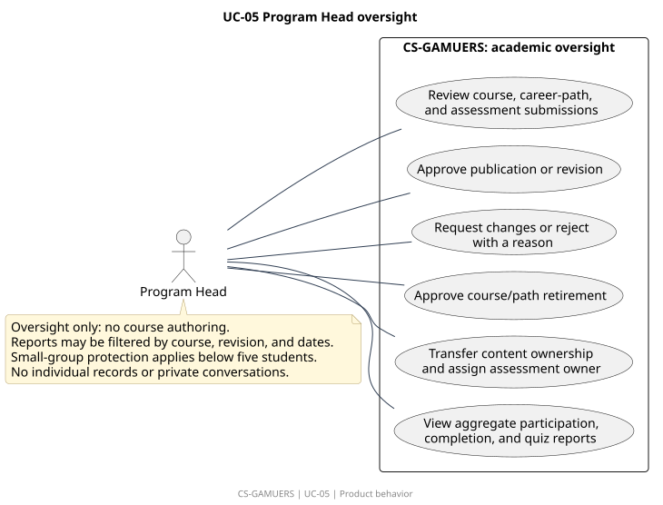

# Use-case diagrams

[All diagrams](../README.md) · [Approved PRD](../../../PRD.md)

| ID | Diagram | Preview | Editable source |
|---|---|---|---|
| UC-01 | Account access and applications | [SVG](uc-01.svg) | [PlantUML](uc-01.puml) |
| UC-02 | Student learning | [SVG](uc-02.svg) | [PlantUML](uc-02.puml) |
| UC-03 | Student guidance | [SVG](uc-03.svg) | [PlantUML](uc-03.puml) |
| UC-04 | Faculty responsibilities | [SVG](uc-04.svg) | [PlantUML](uc-04.puml) |
| UC-05 | Program Head oversight | [SVG](uc-05.svg) | [PlantUML](uc-05.puml) |
| UC-06 | Administrator responsibilities | [SVG](uc-06.svg) | [PlantUML](uc-06.puml) |

## UC-01 Account access and applications

Account-holder goals. The generic actor represents a Student, Faculty member, Program Head, or Administrator under the noted restrictions; it is not a fifth role.

[Editable source](uc-01.puml). Requirements: PERM-01, PERM-05, ACC-01, ACC-02, ACC-03, ACC-04, ACC-05, ACC-06, ACC-07, ACC-08, ACC-09, ACC-10, ACC-13, ACC-14, ACC-15, ACC-16, ACC-17, ACC-20, NOTICE-01, NOTICE-02.

## UC-02 Student learning

Approved Student goals for study and assessment. A complete learning profile is not required to browse or start courses.

[Editable source](uc-02.puml). Requirements: PERM-01, PROFILE-01, PROFILE-02, ASSESS-01, ASSESS-02, ASSESS-03, ASSESS-04, ASSESS-05, CONTENT-03, CONTENT-06, CONTENT-07, DISC-01, DISC-02, DISC-03, DISC-04, QUIZ-01, QUIZ-02, QUIZ-03, QUIZ-04, QUIZ-05, QUIZ-06, QUIZ-07, QUIZ-08, PROGRESS-01, PROGRESS-02, PROGRESS-03, REWARD-01, REWARD-02, DATA-01, P-02, P-03, P-04, P-05, P-06.

## UC-03 Student guidance

Internal recommendations, personal roadmap acceptance, and private AI conversations. External AI roadmaps remain deferred.

[Editable source](uc-03.puml). Requirements: PROFILE-01, PROFILE-02, REC-01, REC-02, REC-03, REC-04, ROAD-01, ROAD-02, ROAD-03, ROAD-04, ROAD-05, ROAD-06, ROAD-07, ROAD-08, ROAD-09, AI-01, AI-02, AI-03, AI-04, AI-05, AI-06, AI-07, PROGRESS-03, DATA-01, P-05.

## UC-04 Faculty responsibilities

Approved Faculty author only owned content and view individual results only for courses currently owned.

[Editable source](uc-04.puml). Requirements: PERM-02, PERM-03, PERM-04, PERM-05, ACC-06, CONTENT-01, CONTENT-02, CONTENT-03, CONTENT-04, CONTENT-05, CONTENT-06, CONTENT-07, CONTENT-08, PATH-01, PATH-02, PATH-03, ASSESS-01, ASSESS-02, ASSESS-03, ASSESS-04, ASSESS-05, NOTICE-01, NOTICE-02, REPORT-03.

## UC-05 Program Head oversight

Program Head oversight covers publication, ownership, and aggregate reports. It does not grant authoring or individual-record access.

[Editable source](uc-05.puml). Requirements: PERM-03, PERM-04, CONTENT-01, CONTENT-02, CONTENT-03, CONTENT-04, CONTENT-05, CONTENT-06, CONTENT-07, CONTENT-08, PATH-01, PATH-02, PATH-03, ASSESS-01, ASSESS-02, ASSESS-03, ASSESS-04, ASSESS-05, REPORT-01, REPORT-02, NOTICE-01, P-07.

## UC-06 Administrator responsibilities

Administrator account support and access control. Learning outcomes and academic publication are outside this role.

[Editable source](uc-06.puml). Requirements: PERM-01, PERM-02, PERM-03, PERM-04, PERM-05, ACC-04, ACC-06, ACC-07, ACC-08, ACC-09, ACC-10, ACC-11, ACC-12, ACC-13, ACC-14, ACC-15, ACC-16, ACC-17, ACC-18, ACC-19, ACC-20, REPORT-03, NOTICE-01, NOTICE-02, DATA-01, P-01, P-08.
