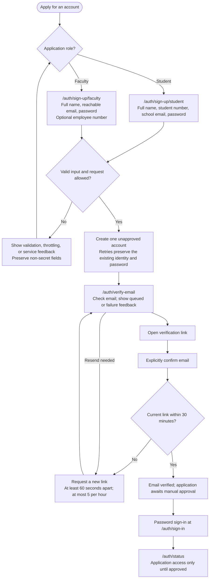
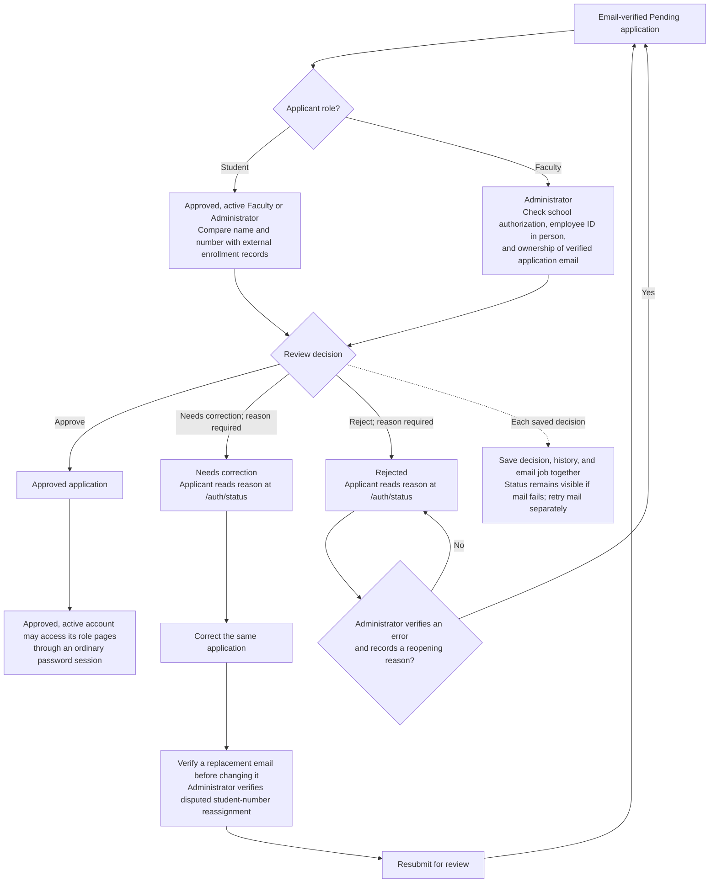
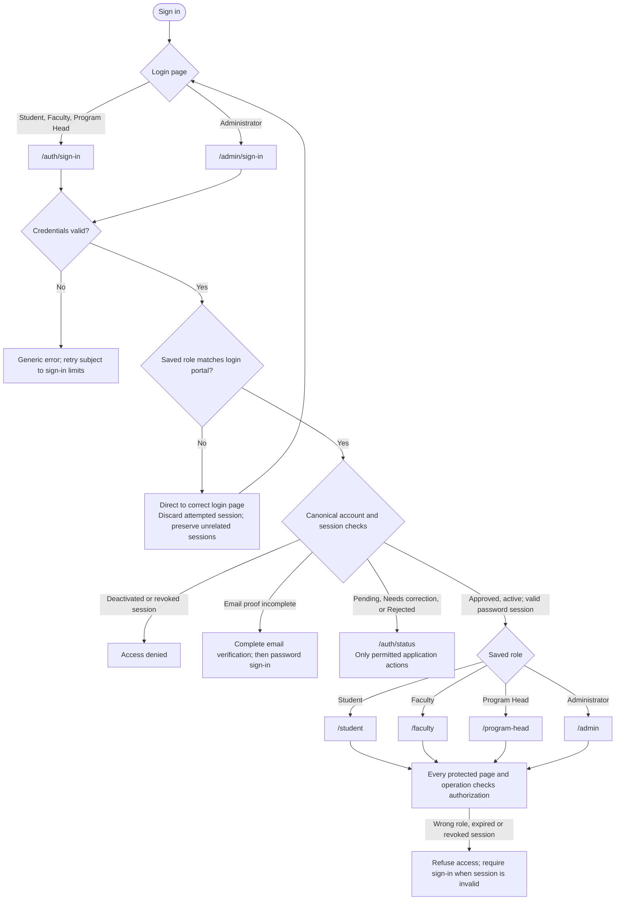

# Role authentication implementation plan

> **For agentic workers:** REQUIRED SUB-SKILL: Use superpowers:subagent-driven-development or superpowers:executing-plans to implement this plan task by task after execution is authorized. Use Ponytail for each implementation task and humanizer for documentation. Steps use checkbox (`- [ ]`) syntax for tracking.

**Goal:** Students and Faculty can apply for accounts, verify their email, receive manual approval, and sign in. Administrators use a separate login route. Each account reaches only its authorized pages.

**Architecture:** Extend the existing single Next.js application and server-only Supabase authentication. Reuse account validation, email verification, session checks, shared controls, and role destinations. Canonical database account state and transaction checks enforce permissions independently of navigation.

**Tech stack:** Existing Next.js 16.4.2, React 19.3.0, TypeScript, Supabase JS 2.118.0/SSR 0.12.7, Tailwind, shadcn/Radix, Vitest, and Playwright; Caddy/local HTTPS and Gmail SMTP as selected in the architecture. No new dependency is selected.

**Spec:** [Product requirements specification](../specs/2026-10-27-cs-gamuers-product-requirements-design.md), [PRD](../../../PRD.md) sections 3, 4, 14, 16, and 17, [TRD](../../../TRD.md), and [ARCHITECTURE](../../../ARCHITECTURE.md), with the owner-approved role flows recorded below. The [earlier authentication and course drafts milestone](../specs/2026-11-03-authentication-and-course-drafts-design.md) supplies existing code; public registration needs its own supported flow.

**Status (2026-11-08): Resumed after the owner's 2026-11-07 pause.** The owner approved the role-flow design and implementation plan on 2026-11-06, then authorized implementation on 2026-11-07 after committing the existing changes. That initial commit is `a8767e8`; implementation is on `feat/role-authentication`, with `HEAD` at `27e70a0` at resumption. Tasks 1 through 4 are implemented and reviewed. This Task 5 snapshot records the acceptance fixes and documentation. The resumed full browser command completed on unchanged source with 104 Chromium/Firefox passes and a WebKit host failure before application navigation; independent Task 5 and whole-branch reviews remain unfinished. See the [pause handoff with evidence and resume steps](../../implementation-status/2026-11-07-role-authentication.md). Full acceptance remains open. Migrations have been applied only to isolated TEST; no public deployment was performed.

**UI reference (2026-11-07):** The owner separately requested the screen-design reference. [Role authentication UI design](../../design/authentication/role-authentication.md) specifies layouts, field rules, copy, states, role boundaries, and acceptance checks for Tasks 1–4. [The visual reference and verification record](../../design/authentication/README.md) complete the design prerequisite; they do not complete implementation tasks or establish runtime acceptance.

## Global constraints

- Read [AGENTS.md](../../../AGENTS.md), relevant PRD requirements, TRD requirements, architecture, and this plan before execution. Read the installed Next.js guides before writing application code. Follow the project Supabase and Postgres skills for affected work.
- Age is excluded. Passwords are separate CS-GAMUERS passwords; school credentials and Google sign-in are not part of this flow.
- Email verification precedes approval. Pending, Needs correction, and Rejected applicants receive only application-status access.
- Deactivated accounts cannot regain access by signing in or registering again. Preserve existing identity, approval state, role, and retained records.
- Student numbers remain text, preserving leading zeros. Email and student-number uniqueness includes pending, rejected, and deactivated accounts.
- Passwords require at least 12 Unicode code points and at most 72 UTF-8 bytes, without trimming or silent truncation. Name limits remain 200 characters, student/employee numbers 50 characters, email 254 characters, and review reasons 2,000 characters under TRD section 6.2.
- Email links expire after 30 minutes. Resend requires at least 60 seconds between issued messages for the same address/purpose and at most 5 in a rolling hour.
- Retain the limits of 10 failed sign-in attempts per normalized identifier per rolling 15 minutes and 100 application-mediated authentication submissions per source IP per rolling 15 minutes. Retain the approved server-only password boundary and native limits for keyless verification.
- The database's saved role and account state determine permissions. A form field, URL, or user-editable metadata cannot grant a role. Ordinary database operations carry the user's verified identity and never fall back to service authority.
- Preserve session existence/revocation checks, password-session requirements, mutation-origin checks, private response caching, and protected opaque email links. Verification/invitation/recovery sessions do not grant ordinary application access.
- Use existing dependencies and local HTTPS with free-only services. No separate backend, public deployment, or paid fallback is selected.
- Use synthetic accounts and the isolated TEST environment for verification. Never reset the shared demonstration database or treat synthetic approvals as real enrollment/employment checks.
- Use the linked role authentication UI reference for the affected screens, reusing the existing UI primitives and tokens when implementation is authorized.
- Password recovery, broader account administration, new invitation-management screens, and dashboard features remain separate work under the PRD. This plan includes the application correction/reopening work described in Task 4.
- Plan approval and saving do not start implementation. Commit instructions from execution skills require separate applicable authorization.

## Review focus

1. Wrong-route sessions: valid credentials on the wrong login route must not establish a new application session or disrupt unrelated existing sessions. Task 1.
2. Duplicate or interrupted registration: concurrent requests and uncertain provider responses must not create duplicate accounts or overwrite an existing identity/password. Task 2.
3. Expired or superseded email proof: link previews must not consume proof, and proof must not grant role access. Tasks 2 and 3.
4. Stale approval decisions: concurrent reviews, corrections, reviewer revocation, and retries must preserve current state and decision history. Task 4.
5. Failed email delivery: a saved application decision remains saved, its current status is visible, and a mail retry cannot repeat the decision. Task 4.

## Approved role flows

| Role | Registration | Approval | Sign-in route | Approved, active destination |
|---|---|---|---|---|
| Student | Full name, student number, `@caloocan.sti.edu.ph` email, password | Approved Faculty or Administrator | `/auth/sign-in` | `/student` |
| Faculty | Full name, any reachable email, password; optional employee number | Administrator | `/auth/sign-in` | `/faculty` |
| Program Head | Existing invitation process | Existing appointment process | `/auth/sign-in` | `/program-head` |
| Administrator | Existing invitation process | Existing appointment process | `/admin/sign-in` | `/admin` |

Student and Faculty signup routes are `/auth/sign-up/student` and `/auth/sign-up/faculty`. They share a form component with the applicable fields. Applicants verify their email, then sign in to `/auth/status` while awaiting approval.

Approved Faculty or Administrators compare a Student's name and number against external enrollment records. Administrators verify Faculty authorization against school records, inspect the school-issued employee ID in person, and confirm that the verified application email belongs to the applicant. No applicant can approve their own application.

Administrators must use the Admin login route. After successful credential verification on the wrong route, direct the person to the correct login page without accepting the attempted application session. Invalid credentials retain a generic error.

The earlier milestone describes shared sign-in for all four roles. The owner approved the separate Administrator entry on 2026-11-06, and it was implemented under this plan on 2026-11-07. Task 5 records verification evidence. Existing permission, session, invitation, and retention guarantees still apply.

## Feature flow

These flows describe the implemented role behavior. The task checklists and acceptance record track its verification, including checks that remain unfinished.

### Signup and email verification

Student emails must use `@caloocan.sti.edu.ph`; student numbers retain leading zeros. Existing email addresses and student numbers stay reserved, including those of rejected and deactivated accounts. Opening a link alone does not consume it. Email proof does not grant learning or staff access.

### Application review and correction

Applicants cannot approve themselves. Program Heads and unapproved Faculty cannot review applications. Reviews check current authorization and application version; a stale or unauthorized decision is refused. Corrections and reopening preserve the same account and records and grant no approval or reactivation. Pending, Needs correction, and Rejected applicants have only application-status access.

### Sign-in and role access

Administrators and Program Heads retain the existing invitation and appointment process: accept the intended invitation, verify email, provide a full name, and set a CS-GAMUERS password, then use the applicable login page. Invitation, recovery, and email-proof sessions alone do not grant ordinary access. The database's saved role and account state control permissions, including direct page and API requests. Signing out returns Administrators to `/admin/sign-in` and other roles to `/auth/sign-in`.

## File map

Create files only in their owning task. Brace notation below enumerates files or directories; it is not a literal path.

| Task | Files | Responsibility |
|---|---|---|
| 1 | `src/features/accounts/session.ts`, `src/lib/supabase/{auth,server}.ts`, `src/config/paths.ts`, `src/app/auth/sign-in/{page.tsx,actions.ts}`, `src/app/auth/sign-out/route.ts`, `src/components/app-shell.tsx` | Portal-aware login, session acceptance, and redirects |
| 1 | New `src/app/admin/sign-in/page.tsx`; move `src/app/auth/sign-in/sign-in-form.tsx` to `src/components/sign-in-form.tsx` | Separate Admin page and reused sign-in controls |
| 2 | New `src/features/accounts/registration.ts`; existing `src/features/accounts/{types,validation}.ts`, `src/lib/supabase/authentication-admission.mjs` and its declarations if affected | Registration, resend, and request admission |
| 2, 4 | CLI-generated files in `supabase/migrations/`; `src/lib/supabase/database.types.ts` | Registration reservations, review transactions, and generated database contracts |
| 3 | New `src/app/auth/sign-up/{student,faculty}/page.tsx`, `src/app/auth/sign-up/{sign-up-form.tsx,actions.ts}`, `src/app/auth/verify-email/{page.tsx,verification-form.tsx,actions.ts}` | Signup, check-email, and resend flows |
| 3 | Existing `src/app/auth/email/{page.tsx,email-form.tsx,actions.ts}`, `src/features/accounts/{email-links,email-protocol}.ts`, `src/app/auth/sign-in/page.tsx`, `src/app/page.tsx`, `src/config/paths.ts` | Verification completion, expired-link guidance, and entry links |
| 4 | New `src/features/accounts/applications.ts`, `src/app/{admin,faculty}/applications/{page.tsx,actions.ts}`, `src/components/application-review.tsx`; existing `src/features/accounts/types.ts` | Authorized application queries and reviewer actions |
| 4 | Existing `src/app/auth/status/page.tsx`; new `src/app/auth/status/{actions.ts,application-form.tsx}`; existing `src/components/app-shell.tsx`, `src/config/paths.ts` | Applicant status, reasons, corrections, and reviewer navigation |
| 4 | Existing `scripts/mail-worker.mjs` and account email-operation files as required by the protected identity-change flow | Decision notices and verified identity corrections |
| 1 through 5 | Tests named in the tasks and affected fixtures in `tests/integration/helpers/` | Role, identity, permission, retry, and browser checks |
| 5 | `ARCHITECTURE.md`, this plan, relevant spec entries, and `docs/demo/README.md` | Aligned flow descriptions and measured verification evidence |

## Task 1: Separate Administrator sign-in

**Interfaces:** Extend the existing service to `signIn(input: { email: string; password: string }, portal: 'standard' | 'admin'): Promise<SignInResult>`. Each Server Action supplies its portal explicitly. Extend `SignInResult` with a wrong-portal outcome containing only an allowlisted login destination. Update every existing caller and test for the added argument.

- [x] Add failing tests in `tests/unit/session.test.ts` and `tests/e2e/auth.spec.ts` for every role and both login routes. Assert the approved destination table, wrong-route refusal, generic invalid-credential errors, and preservation of unrelated existing sessions. Update `tests/unit/sign-in-form.test.tsx` for the moved shared form.
- [x] Run `npm test -- tests/unit/session.test.ts tests/unit/sign-in-form.test.tsx` and the affected browser checks using the established isolated HTTPS harness. Confirm failures are the missing portal behavior, not missing environment setup.
- [x] Authenticate into a temporary server-held session, check the canonical role and account state, then persist cookies only for an accepted login. Reuse existing Auth transport and database guards; tokens stay server-side.
- [x] For valid credentials on the wrong route, discard the attempted session and direct the person to the correct login page. Invalid credentials retain a generic error. Preserve unrelated existing sessions.
- [ ] Add the Admin page and reuse the shared sign-in form. Update protected-page and sign-out redirects so Administrator flows return to `/admin/sign-in`; protect the login page from redirect loops. Keep destinations allowlisted.
- [ ] Repeat the focused tests and exercise direct cross-role URLs, expired sessions, sign-out, and browser Back. Record passing evidence and any unverified hosted/browser coverage.

**Passing outcome:** Each approved, active role reaches its destination. An Administrator cannot establish a new application session through standard sign-in, and another role cannot establish one through Admin sign-in.

## Task 2: Add the public registration service

**Interfaces:** Create `registerAccount(input: unknown): Promise<RegistrationResult>` and `resendVerification(email: string): Promise<VerificationResult>` in `src/features/accounts/registration.ts`. Registration results distinguish validation errors, accepted requests, throttling, and service failure. Verification results distinguish acknowledgment, invalid input, throttling, and service failure without exposing another account's state. Neither result returns passwords, native tokens, or another account's details. Reuse `AccountInput` and `validateAccountInput`.

- [x] Add failing tests in `tests/unit/registration.test.ts` and `tests/integration/registration.test.ts`. Assert exact school-domain enforcement, reachable non-Gmail Faculty addresses, preserved leading-zero student numbers, 12-code-point/72-byte password boundaries, and rejection of privileged-role input.
- [x] Run `npm test -- tests/unit/registration.test.ts tests/integration/registration.test.ts` against the isolated TEST environment. Confirm failures identify the missing public-registration behavior.
- [x] Inspect installed Supabase CLI help, then create the registration migration through the CLI. Add a server-only reservation operation that permits only Student and Faculty applications. Keep demonstration setup operations restricted to their existing purpose. Regenerate database types from the intended target.
- [x] Create an unconfirmed Auth account through the existing protected creation mechanism, then issue verification through the current email hook and worker. Administrative creation remains server-only. Do not auto-confirm email or approve the application.
- [x] Apply authentication admission to the public entry points. Bind interrupted attempts to a secure registration capability. Resolve an existing reservation after an uncertain response; retries must neither create duplicates nor overwrite an existing account's identity or password. Do not persist the password for background retries.
- [x] Add and run concurrency/failure assertions: simultaneous duplicate requests create at most one account; a retry after uncertain creation resolves that account; creation or email failure never grants access; existing pending/rejected/deactivated identifiers remain reserved. Confirm no ordinary access is granted by signup or proof alone.

**Passing outcome:** A valid application creates one unapproved account. Neither registration nor email verification grants learning or staff permissions.

## Task 3: Connect Student and Faculty signup screens

**Interfaces:** Both role-specific pages call the Task 2 services through validated Server Actions. Reuse the existing `/auth/email` confirmation interface. `/auth/verify-email` provides check-email and resend feedback without exposing account existence or proof credentials.

- [x] Add failing form tests in `tests/unit/sign-up-form.test.tsx` and browser flows in `tests/e2e/registration.spec.ts`. Assert the fields for each role, absence of age, correct autocomplete/labels, and preservation of non-secret values after errors.
- [x] Run `npm test -- tests/unit/sign-up-form.test.tsx` and the affected browser checks. Confirm failures identify missing signup behavior. Apply the linked UI reference when implementing the affected screen layouts.
- [x] Connect the role-specific forms to Task 2. Validate again on the server; never accept approval or privileged-role values from the browser. Keep Student number inputs textual.
- [x] Show a check-email outcome, verification completion, resend feedback, and expired-link guidance. Describe mail as queued when delivery has not been confirmed. After verification, direct the applicant to ordinary password sign-in and the application-status flow.
- [x] Preserve non-secret form values after errors. Keep passwords out of URLs, logs, persistent browser storage, and returned form state. Reuse existing pending, focus, and error-feedback patterns.
- [x] Verify that opening an email link does not consume it; confirmation requires the existing POST action. Test expiry at 30 minutes, superseded links, throttling, unavailable services, and the absence of role access after proof. Repeat focused form tests and the affected registration/email browser flows.

**Passing outcome:** Both roles can submit and verify an application, then sign in to `/auth/status` while awaiting approval.

## Task 4: Complete application review and correction

**Interfaces:** `src/features/accounts/applications.ts` exposes operations to read one's own application, list authorized applications, review an application, save permitted corrections, resubmit, and reopen a rejected application. Mutations carry the expected application version; review decisions also carry a unique request ID. Callers receive only authorized identity/application fields, state, applicable reasons, and safe errors. Ordinary reviewer operations use the request-scoped user client and transaction authorization.

- [x] Add failing tests in `tests/integration/applications.test.ts` and `tests/e2e/applications.spec.ts`. Assert Faculty can review Students only; Administrators can review Students and Faculty; self-approval, unapproved reviewers, and Program Head review access are denied. Include direct API calls under ordinary role sessions.
- [x] Run `npm test -- tests/integration/applications.test.ts` against isolated TEST and the affected browser checks. Confirm failures identify missing review behavior.
- [x] Create the review migration through the CLI and update database types. Add application-version checks and authorized review transactions. Preserve existing audit events; replace the current one-event-per-account restriction with decision-level idempotency so repeated correction/review cycles retain their history.
- [x] Implement Approve, Needs correction, and Reject. Require a reason for correction or rejection. Applicants can correct and resubmit the same application; only an Administrator can reopen a rejection with a recorded reason. Reviewers must complete the applicable external identity/enrollment checks before approval.
- [x] Preserve verified identity rules during corrections. Replacement email requires fresh proof and the existing protected identity-change mechanism. Disputed student-number reassignment requires Administrator verification. Neither correction nor reopening grants approval, changes role, reactivates an account, or loses existing records.
- [x] Commit each decision, history event, and email job in one database transaction. Extend the mail worker to deliver application decisions with the applicable correction/rejection reason. A failed email must not undo or repeat the decision; mail retries remain independent of decision retries.
- [x] Add the authorized reviewer pages and applicant status/correction controls using the linked UI reference and existing primitives. Faculty see only the identity/application information needed for Student verification. Include status, decision reason, correction feedback, and permitted next actions.
- [x] Verify stale-review rejection, duplicate submissions, reviewer revocation, applicant isolation, and failed email delivery. Extend `tests/unit/mail-worker.test.ts` for the decision notices. Run `npm test -- tests/integration/applications.test.ts tests/unit/mail-worker.test.ts` and the application browser flows; record evidence.

**Passing outcome:** Every application state has a usable path. Faculty see only the applicant information needed for Student verification; approval grants no additional access to private learning records.

## Task 5: Verify the complete role flows and align documentation

**Interfaces:** Use the Task 1 login portals, Task 2 registration services, Task 3 signup/proof flows, and Task 4 review/correction operations. Update affected fixtures and navigation expectations while preserving existing invitation and Faculty course-draft behavior.

- [ ] Run the focused unit and integration tests from each task, first confirming the expected failure and then the passing implementation. Use the existing isolated-target and fixture-cleanup protections. Skipped hosted tests are missing coverage, not passing evidence.
- [ ] Run `npm run typecheck`, `npm run lint`, `npm run format:check`, and `npm test`. Resolve regressions introduced by this work.
- [ ] Run `npm run test:e2e`, including Chromium, Firefox, and WebKit. Use `npm run browser -- <command>` with the project Playwright CLI skill to inspect the changed flows at desktop and 320 CSS pixels, with long content, keyboard operation, visible focus, labels, console errors, and failed requests. Check dialog focus where a dialog is introduced. Close browser sessions and servers started for verification.
- [ ] Verify real school-inbox and personal-email delivery, and direct Auth/Data API denial cases in isolated TEST. Follow TRD section 6.5's latest-two-stable browser scope and actual Android Chrome/iPhone Safari checks. Record exact engines, versions, devices, and missing coverage; desktop emulation does not prove physical-device behavior.
- [ ] Confirm the architecture and relevant specification references remain aligned with the implemented Administrator route. Preserve historical milestone evidence. Record measured evidence and pending checks in this plan and the demonstration documentation without exposing account identities, credentials, or proof material.

Migration commands must explicitly select the intended test environment after inspecting the installed CLI's help. Current Supabase CLI releases changed target-selection behavior; do not copy obsolete flags or assume a default target.

**Passing outcome:** Each role's successful and denied flows are demonstrated, existing account records are preserved, and all required checks have evidence or a stated blocker. A blocker remains unfinished acceptance work; it is not a waiver of the relevant requirement.

## References and acceptance record

- [Supabase administrative user creation](https://supabase.com/docs/reference/javascript/auth-admin-createuser): server-only provider operation referenced in Task 2.
- [Supabase CLI target-selection change](https://supabase.com/changelog/supabase-cli-v3): recheck installed CLI help before migration work.
- [Previous implementation plan](2026-11-03-authentication-and-course-drafts.md): existing code and scoped evidence, not authorization for this extension.

The implementation follows the approved role-flow design and UI reference. Task reviews accepted the separate login portals, public registration, signup and email screens, and application review/correction through `27e70a0`, with minor follow-ups implemented in this Task 5 snapshot. The owner resumed work on 2026-11-08. The full shared browser attempt completed as recorded below; remaining acceptance includes working WebKit coverage, independent reviews, real inbox delivery, the required stable-browser and physical-device scope, and fresh full-suite verification after the approved isolated TEST bootstrap-fixture recovery. A recorded blocker keeps the affected acceptance item open.

### Measured evidence (2026-11-07)

All hosted checks used isolated TEST and synthetic accounts with run-owned cleanup. No real enrollment or employment verification is claimed. Passwords, proof material, account identities and private captures are excluded from this record.

| Work | Evidence |
| --- | --- |
| Separate portals and staged sessions | Task 1 focused unit tests: 29 passed after meaningful failures. Its Chromium/Firefox run passed 41 of 42; the remaining Chromium pending timeout passed unchanged on a focused rerun. Task 5 adds regression coverage for sign-out from a revoked/deactivated Administrator page. |
| Registration and resend | Task 2 focused registration checks: 26 passed, one native-hook opt-in skipped. Duplicate requests, uncertain creation, immutable identity/password, retained identifiers and orphan-reservation recovery were exercised. Independent review found an account-eligibility leak in resend errors; the fix passed 15 focused checks and scoped re-review. |
| Signup, email confirmation and invitation | Task 3 focused UI checks: 17 passed. Chromium/Firefox browser checks: 26 passed, four native opt-ins skipped. Separate actual native Student and Faculty browser flows passed on Chromium 156.0.8078.4 at 04:13–04:14 UTC: registration, configured hook, 1,800-second proof, explicit confirmation and password sign-in to Pending status. |
| Application review and correction | Task 4 production browser checks: 18 passed across Chromium/Firefox, followed by two focused Firefox passes without diagnostic waits. SQL tests cover ordinary-role denial, version conflicts, reviewer revocation, idempotency, retained identifiers, replacement proof and atomic history/mail. The draft-preservation review fix passed four units and four Chromium/Firefox checks. |
| Native boundaries | Task 5's explicit gateway probe passed 57 gateway denials and two invalid keyless verification requests. Its actual native resend/hook integration probe passed separately after correcting a stale expected proof-state label. Generated-proof transport in repeatable tests does not establish native-hook invocation or inbox receipt. |
| Natural session expiry | Two Student password sessions were left untouched for their real 3,600-second JWT lifetime. After expiry, the valid session renewed at 06:34:22 UTC and retained approved Student access; the natively revoked session reached session-ended guidance and could not open the protected page. CLI Chrome at 1280 × 800 only; both checks had zero console errors or failed requests. The exact run and credential snapshots were cleaned. |
| Focus, reflow and timestamps | Task 5's focused signup checks passed 40 units and 14 Chromium/Firefox browser cases. The final mobile-menu reflow/focus cases passed in both engines, including pointer and keyboard opening. A later CLI console audit exposed a date hydration mismatch; actual applicant/reviewer hydration tests reproduced both failures, then six focused hydration/status units passed with explicit Philippine-time formatting. The final actual Chrome CLI reload had zero errors at desktop and 320/200% text. The resumed full run passed the saved-decision reload and hydration-console assertions in both Chromium and Firefox; WebKit could not create a page. |
| Full unit/integration suite | Task 5: 326 passed, two failed, two opt-in skips across 40 files. One failure is the preserved bootstrap conflict. Native recovery verification failed before the permission assertion, then passed its focused diagnostic rerun. A nearby provider verification rate limit is consistent with that failure; the original result lacks the request ID/code needed to establish the cause. Native quotas were unchanged. |
| Static checks and production build | Final typecheck, lint (zero errors/warnings), format, whitespace and document-link checks passed after the timestamp fix. Production builds passed with 20 routes. Earlier failures and narrower reruns remain part of the evidence. |
| Interrupted final browser matrix | The owner paused the fresh 162-case run after **48 Chromium passes, one interrupted case and 113 not run**, exit 130. The Administrator invitation case was interrupted; Firefox and WebKit had not started. This is an incomplete run, not a full pass or an observed application failure. Processes stopped and fixture cleanup was verified. |
| Resumed full browser matrix (2026-11-08) | On unchanged application/test source, exact `npm run test:e2e` orchestration discovered 162 tests across all three projects. **104 passed (52 Chromium and 52 Firefox), four native-mail opt-ins skipped, one WebKit setup failure and 53 not run**, 7.8 minutes. The WebKit failure was `browserContext.newPage: Protocol error (Page.overrideSetting): Unknown setting: PushAPIEnabled`, before app navigation. Earlier native probe passes remain separate from those skips. |

The first full browser run and subsequent attempts exposed stale navigation assertions and an intermittent signup-feedback focus failure. Tests now wait for visible navigation outcomes; signup feedback focuses after React commits it. Desktop and 320 CSS pixel CLI checks also exposed overflow at 200% text size and mobile menu focus-return defects. Shared controls were corrected and received focused browser regression checks. The resumed full command exercised these fixes across all executed Chromium/Firefox cases. Its WebKit failure and unexecuted coverage remain open; earlier partial passes are not substituted for a complete three-engine pass.

Application decision times now use an explicit `en-PH` locale and `Asia/Manila` time zone, with a visible GMT+8 label. Submitted dates use the same display policy. Stored timestamps are unchanged. The browser regression reloads a saved decision and checks recoverable hydration console errors as well as uncaught page errors.

### TEST migration record

The installed CLI created each migration file. The connector applied the exact SQL to the verified TEST target and assigned its own timestamp. Match by migration name and SQL when comparing histories; do not bulk-push local timestamps into an already migrated target. TEST fixture functions are separate from the application migrations below and must never be installed on DEMO.

| Local migration file | Hosted TEST version |
| --- | --- |
| `20261107032601_public_registration.sql` | `20261107032956` |
| `20261107033128_registration_verification_target.sql` | `20261107033229` |
| `20261107034013_reclaim_expired_public_registration.sql` | `20261107034035` |
| `20261107040042_invitation_completion_details.sql` | `20261107040224` |
| `20261107040401_atomic_invitation_details.sql` | `20261107040503` |
| `20261107043123_application_review.sql` | `20261107043404` |
| `20261107043451_application_actor_lock.sql` | `20261107043511` |
| `20261107043837_application_identity_correction.sql` | `20261107044038` |
| `20261107044605_application_creation_dates.sql` | `20261107044642` |
| `20261107045028_application_identity_notices.sql` | `20261107045144` |
| `20261107045236_initial_demo_application_review.sql` | `20261107045334` |
| `20261107045620_replacement_proof_admission.sql` | `20261107045703` |
| `20261107050551_finalize_committed_identity.sql` | `20261107050711` |
| `20261107052043_ordered_application_mail.sql` | `20261107052049` |

Fresh read-only inspection confirmed the Task 4 migrations and that the account guard role has neither Auth-schema usage nor direct `auth.users` SELECT permission. Historical application dates were backfilled once from native account creation dates; runtime grants were not widened. DEMO remains unchanged and requires its own explicit migration and rollout verification before this extension is demonstrated there.

### Unfinished acceptance

| Requirement | Current blocker or missing evidence |
| --- | --- |
| Bootstrap integration check | The earlier full suite failed against an older-run singleton. Owner-authorized exact-run recovery completed on November 8 at 03:28:20 UTC; all 18 unrelated-table count/digest pairs matched, the protected TEST marker remained intact and the recovery journal was removed. Root's fresh full unit/integration run is pending in this snapshot. Task 5 performed no hosted calls during this documentation/commit pass. |
| WebKit | The resumed full command failed in `browserContext.newPage` with `Page.overrideSetting: Unknown setting: PushAPIEnabled` on the pinned macOS 14.5 WebKit build, before navigation. No WebKit application pass is claimed; 53 cases were not run. |
| Latest two stable browser versions | Bundled Chromium 156 and Firefox 157 Nightly, installed Chrome 157 and Safari 17.5 do not cover TRD section 6.5's full Chrome/Edge/Firefox/Safari matrix. |
| Physical devices | Actual Android Chrome and iPhone Safari behavior, local certificate trust and network access remain unverified. Desktop emulation is separate evidence. |
| Real inbox delivery | School and personal inbox receipt and completion by their holders remain unverified. Native hook queues and generated proofs are not delivery evidence; no real outbound worker was started. |
| Final shared verification and review | The resumed full attempt completed with 104 Chromium/Firefox passes, four opt-in skips and the WebKit setup blocker. Task 5 independent review and whole-branch review remain unfinished. Neither that result nor this source snapshot closes full acceptance. |
