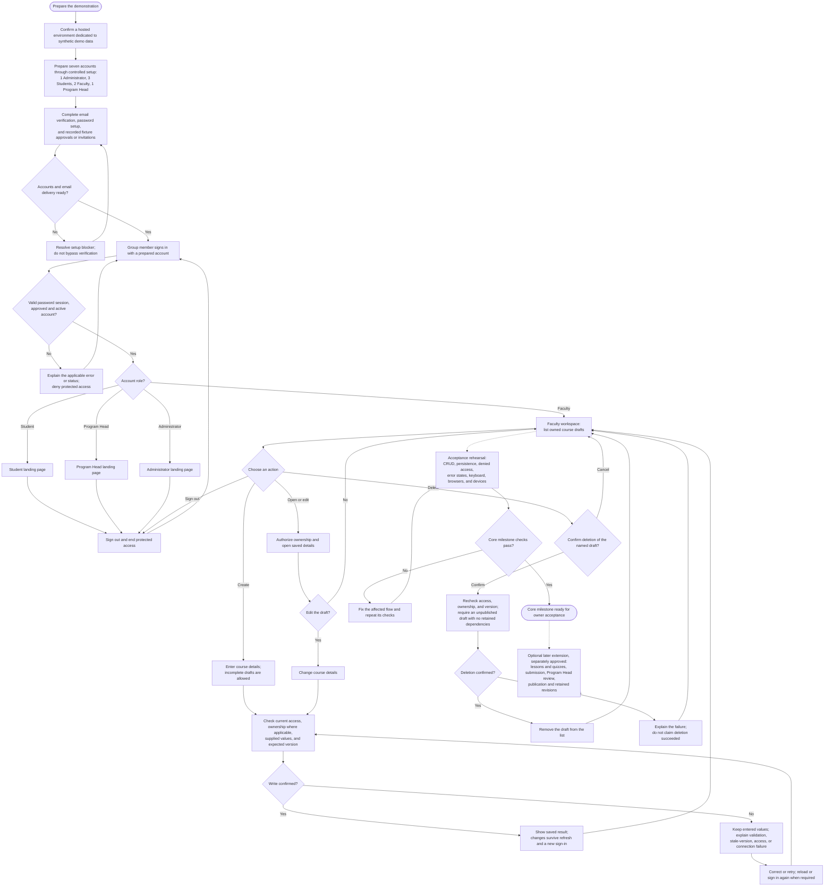

# Authentication and course drafts milestone

Status: approved by the product owner on 2026-11-03, including the milestone flowchart. The owner selected prepared synthetic demonstration accounts that group members can use to act as the four roles. Approval authorizes the scope documentation and preparation of the implementation plan; application implementation, account creation, provisioning, and deployment have not been authorized.

Current extension (2026-11-07): the owner later approved and authorized implementation of the [role authentication plan](../plans/2026-11-06-role-authentication.md). Student/Faculty application, email verification, manual review and same-account correction are now implemented in source and isolated TEST. Administrators use `/admin/sign-in`; Student, Faculty and Program Head use `/auth/sign-in`. The shared-login and deferred-onboarding descriptions below retain the original milestone boundary. Current acceptance and remaining DEMO rollout are recorded in that plan and [demonstration readiness](../../demo/README.md). Password recovery, general account administration, new invitation-management screens and deployment remain outside the extension.

## Purpose and authority

Demonstrate how CRUD supports CS-GAMUERS through Faculty course-draft management, with real sign-in and enforced permissions. This is an implementation milestone within the full product. It does not reduce the overall product requirements.

Read [AGENTS.md](../../../AGENTS.md), [PRD.md](../../../PRD.md), [TRD.md](../../../TRD.md), [ARCHITECTURE.md](../../../ARCHITECTURE.md), and [DESIGN_SYSTEM.md](../../../DESIGN_SYSTEM.md) as the canonical requirements. This document selects a delivery boundary; omitted features remain future work.

## Approaches considered

| Approach | Trade-off | Decision |
|---|---|---|
| Full onboarding plus draft CRUD | Demonstrates registration and account review, but adds application screens, recovery, invitations, and more email-dependent flows before CRUD is ready | Defer the full account-management experience |
| Prepared accounts, real sign-in and permissions, draft CRUD | Focuses the presentation on persistent CRUD and access boundaries; still requires secure, verified account preparation | Selected by the owner; detailed scope proposed below |
| Mock sign-in or an unrestricted role switcher | Quicker to present but does not establish authentication or authorization | Excluded |

## Necessary scope

### 1. Prepare demonstration accounts

Prepare the architecture's one Administrator, three Students, two Faculty, and one Program Head. Two Faculty accounts are necessary to demonstrate ownership isolation. Email addresses must be controlled by the participants; Student addresses must meet the school-domain requirement.

The owner selected synthetic accounts in an isolated demonstration environment. Group members may act as Faculty, Program Head, Administrator, or Student regardless of their real school position. Clearly label fixture identities and approvals as test data; they are not evidence of real enrollment, employment, or appointment checks. Never invent school verification evidence or create fixture approval paths in an environment holding real school accounts. Email ownership proof and normal sign-in/permission enforcement still apply.

Use a hosted Supabase project dedicated to synthetic demonstration data, separate from any real school environment. The existing development project may fill that role only after confirming it contains no real school accounts/records and explicitly designating it demo-only. Otherwise, a separate hosted project is required, subject to free allocation availability. The app selects the project through server environment configuration and project-specific credentials. A Git branch, role column, or demo label alone does not isolate accounts. Automated integration/global-invariant tests still require the separate isolated test environment prescribed by TRD section 6.5; never reset the shared demonstration database.

Provide a controlled operator setup workflow, not public setup endpoints. Bootstrap the designated Administrator by invitation; invite the Program Head through the authorized Administrator. Prepare Student and Faculty applications, verify email ownership through actual links, and record authorized application approvals with their actors. Account holders choose their own passwords. Do not silently mark emails verified, place preset passwords in seeds, or make the setup command an unrestricted role-assignment tool.

Public onboarding screens are deferred; the necessary setup interfaces, email-link completion screens, and backend operations are included. Reuse these operations when onboarding screens arrive. Setup must retain canonical identity validation, uniqueness, invitation binding, no self-approval, decision history, and applicable notices. Re-running interrupted setup must resume known records rather than duplicate accounts or approvals.

This work includes the required Auth email hook, delivery worker, opaque application links, expiry/resend enforcement, and invitation acceptance/password setup described in ARCHITECTURE sections 3–4 and TRD section 6. It is a real prerequisite, not a seed-file shortcut. Verify actual email delivery before treating the accounts as ready. If the required school inboxes or sender are unavailable, report the blocker; do not bypass verification.

### 2. Sign in and sign out

The original 2026-11-03 milestone used one email/password sign-in page. The implemented 2026-11-06 extension now requires `/admin/sign-in` for Administrators and `/auth/sign-in` for Student, Faculty and Program Head accounts. Successful sign-in leads to the account's role destination. Sign-out ends access to protected pages and operations. Handle incorrect credentials, unavailable service, expired sessions, and inactive/unapproved accounts without exposing account existence or raw provider errors.

Include simple role landing pages with account role and sign-out. Faculty also have a clear route to their drafts. Other roles receive an honest milestone landing page, without pretend reports, learning records, or enabled links to unimplemented features.

### 3. Enforce fixed permissions and ownership

Use the four existing PRD roles. No permission editor, custom roles, or role switcher is included. Canonical database account state determines role, approval, activation, and current ownership; user-editable Auth metadata cannot grant access.

Check authorization in feature operations and database RLS/transaction boundaries, including direct Data API requests. Route hiding and navigation checks are supplementary. Enforce the architecture's session guard, including session existence, password-authenticated access, and revocation cutoff. Verification/invitation/recovery sessions cannot access drafts as ordinary sign-in sessions.

Only an approved, active Faculty owner can create or mutate their drafts. A second Faculty member cannot list, open, update, delete, or claim those drafts. Student, Program Head, and Administrator roles cannot author drafts. Program Head content oversight remains a later UI scope under the canonical permissions; this milestone does not redefine that role's eventual read access. Administrators do not receive content-authoring powers.

### 4. Persist course-draft CRUD

The proposed editor covers course details only: title, description, primary topic, difficulty, learning outcomes, optional prior-knowledge guidance, and optional estimated study hours. Use the PRD topic/difficulty values and TRD field bounds. Editing outcomes includes adding, changing, removing, and retaining their order. Prerequisite-course references wait for catalog work.

Faculty may save incomplete drafts. Missing publication-required content must not block draft saving; supplied invalid values must produce field errors without losing entered data. Blank optional study hours are valid; supplied hours must be positive and finite. A blank title appears as an interface fallback such as "Untitled draft" without silently replacing stored content.

| CRUD operation | Demonstrated behavior |
|---|---|
| Create | Save a new incomplete course draft with the authenticated Faculty as owner |
| Read | List owned drafts and open their saved details; show a useful empty state |
| Update | Edit and save details; refresh or sign in again and see the persisted result |
| Delete | Confirm the named unpublished draft's deletion, cancel safely, then remove only the authorized draft |

Keep course identity, ownership, draft revision, and version information consistent with the architecture. Do not build the full future learning schema. Reject stale updates/deletions so two tabs cannot silently overwrite or remove newer work; preserve entered edits and explain how to reload. Prevent repeat activation while a request is pending, and show success only after persistence is confirmed.

Deletion is restricted to unpublished drafts with no retained publication/learning dependencies. Published content has no hard-delete path. This milestone creates no published courses and offers no Submit or Publish control.

### 5. Verify the demonstration

Use synthetic test records and isolated integration data. Never reset the ordinary hosted development database. Real role sessions must prove database permissions; service-key success does not establish RLS correctness.

- All roles can sign in to their correct destination and sign out. Wrong credentials, expired/revoked sessions, pending/deactivated accounts, and email-proof-only sessions fail safely.
- Faculty A completes CRUD and sees saved changes after refresh and a new sign-in. Canceling deletion preserves the record.
- Faculty B and non-author roles cannot perform Faculty A's CRUD through guessed URLs, forged mutations, ownership changes, or direct database API calls.
- Incomplete drafts save; invalid supplied input preserves edits and displays errors. Long Unicode content, blank titles, optional hours, stale tabs, repeated activation, and failed saves have defined visible outcomes.
- Inspect keyboard operation, labels, visible focus, delete-dialog focus/return behavior, desktop layout, 320 CSS pixel layout, long content, and overflow. Check console errors and failed network requests.
- Run relevant unit/integration tests, lint, formatting, type checks, build, and the shared Playwright suite. Include Chromium, Firefox, and WebKit checks for the delivered flows, and actual Android Chrome/iPhone Safari rehearsal under TRD section 6.5. Record actual versions/coverage and any blockers rather than claiming unperformed checks.

## Delivery order

1. Confirm email delivery, controlled account preparation, isolated test environment, and local HTTPS/device trust. These are the main external dependencies.
2. Implement sign-in, sign-out, account/session checks, fixed permissions, and minimal role destinations. Prove negative access before building the editor.
3. Implement persistent draft creation and reading, followed by editing and confirmed deletion. Reuse installed UI components and approved tokens.
4. Run security/browser acceptance checks and rehearse the presentation on the intended network/devices.
5. Consider publication only after the core milestone passes and a separate extension scope is approved.

The detailed implementation plan will map these deliverables to files, interfaces, migrations, and test steps after this scope is approved. Implementation remains a separate authorization.

## Milestone flowchart

This flowchart describes the proposed demonstration scope. Account preparation happens before the presentation. The permission checks apply to every protected request, including direct requests; a role landing page alone grants no access. Non-Faculty landing pages do not include their later product workflows.

Solid arrows show demonstration setup, user actions, and outcomes. Dotted arrows show verification and a possible later extension; they are not buttons in the Faculty workspace. Published content cannot be deleted through this flow. Each protected action may stop when its access check fails, even if the person previously signed in successfully. An unauthorized draft open returns no draft details. After save failure, returning to the workspace must not silently discard preserved edits; stale conflicts require deliberate reload, and uncertain writes require checking the saved state before reporting success.

## Left out of this milestone

| Feature | Why it waits |
|---|---|
| Public registration, application-review dashboards, invitation-management screens | Prepared accounts let the presentation begin at sign-in; secure setup operations still exist |
| Password recovery and assisted identity/email correction screens | Separate account workflows with additional proofs and session-revocation cases; use known working demo accounts and do not advertise unavailable recovery |
| Role-change, deactivation/reactivation, ownership-transfer screens | Additional administrative workflows and safeguards; existing account state and session guards still apply |
| Lesson/resource and quiz editors, PDF upload/scanning, Markdown rendering | Course details can remain an incomplete draft; these require more content validation, storage/scanning, and authoring UI |
| Submission, Program Head review, publication, revisions of published content, retirement | A coherent review lifecycle is larger than a Publish button; publication requires complete lessons/resources and at least one required quiz |
| Student catalog, starting courses, saved attempts, progress, badges | Depend on approved content and introduce revision, scoring, concurrency, and retention guarantees |
| Career paths, assessment, profile-based suggestions, roadmaps, AI chat | Independent product work unnecessary to demonstrate draft CRUD |
| Aggregate reports and administrative-history dashboard | No learning/reporting scope yet; required setup/security events are still recorded without building dashboard screens |
| Configurable permissions, custom roles, public deployment, paid services | Outside the selected product/architecture decisions |

Deferred account flows must not remain usable through unrestricted native Auth APIs. Implement the required guards or disable the unsupported operation until its compliant flow exists. Do not create an insecure alternative simply because its application screen is absent.

## Publication extension

Publication is a separately planned extension, not part of core acceptance or a promise for the next day. Its minimum useful scope includes lesson resources, complete quizzes with protected answer keys, submission validation and frozen snapshots, Program Head approval/change-request/rejection with required reasons, stale-review protection, immutable published revisions, applicable notices, and an authorized student read view. PDF support, learner participation, and later revision/retirement interactions need explicit boundaries and tests before this extension can be accepted. Prefer written resources initially if separately approved; do not add unscanned PDFs.

## Structure and remaining builder choices

Retain the single Next.js App Router application and hosted Supabase architecture. Routes compose screens and use thin request entry points; account/content operations live under their feature modules, shared access and service connections under `src/lib/`, environment/path configuration under `src/config/`, migrations/seeds under `supabase/`, and controlled setup/maintenance commands under `scripts/`. Use existing test locations and installed shared UI components. Do not add empty future feature folders or another backend.

The detailed plan chooses exact filenames, function signatures, and relational tables after checking installed Next.js guides and current Supabase guidance. Keep secrets server-side, normal queries user-scoped, protected responses private/no-store, mutation origins checked, and redirect destinations allowlisted. Local HTTPS uses Caddy and trusted device certificates as already selected; no public tunnel or deployment is included.

No implementation-time estimate has been established. Email setup and Auth integration may consume most of the available time. If those prerequisites fail, report the resulting deadline risk and agree a revised scope; do not replace real authentication with a role switcher or silently weaken canonical controls.

## Owner review

The owner approved this specification, its flowchart, and the [implementation plan](../plans/2026-11-03-authentication-and-course-drafts.md) on 2026-11-03. The course-details-only editor, synthetic demonstration accounts, fixed permissions, account-setup prerequisites, and publication deferral are included. The owner explicitly instructed: “Do not start the implementation.” Implementation requires a subsequent instruction to proceed.
